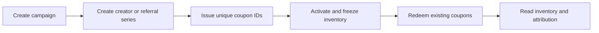

# Tipper Tickets

**Pre-issued creator coupons and referral attribution on Starknet.**

[](https://github.com/rieles3/tipper-tickets/actions/workflows/ci.yml)
[](LICENSE)
[](Scarb.toml)

[Español](docs/README.es.md) · [Contract reference](docs/CONTRACT.md) · [Sepolia](docs/SEPOLIA.md) · [Interactive demo](demo/README.md) · [Contributing](CONTRIBUTING.md)

Tipper Tickets gives campaigns a fixed, auditable coupon inventory. Each coupon has a unique ID, belongs to a creator or referral source, and can be redeemed once. Activation permanently freezes issuance; redemption consumes an existing coupon and preserves its history.

## Two use cases

| Product | Example | What the contract records |
| --- | --- | --- |
| Creator coupons | A campaign assigns `MARIA10` to a creator | Pre-issued inventory and redemptions attributed to that creator |
| Web referrals | A referral link identifies the person who brought a conversion | One redemption per application-supplied conversion reference, across the campaign |

A visit or click does not automatically burn a coupon. The integrating application validates the business event, then an authorized operator submits its redemption. The contract enforces inventory, permissions and deduplication; it does not independently establish that a purchase or a real person exists.

## How it works



1. Set an immutable supply cap and expiration date.
2. Allocate series to creators or referrers, with a public code and supply cap.
3. Issue coupons in batches of up to 100 while the campaign is in `Draft`.
4. Activate the campaign to freeze its actual issued inventory and series.
5. Redeem each coupon once, recording its source, operator and conversion reference.

**Example:** cap **100** → issue **50** → activate → redeem **20** → **30** unconsumed. Issuance remains **50** forever; the unused capacity cannot be minted after activation.

Coupons are non-transferable contract records, not ERC-721 tokens. “Burn” means an irreversible transition to `redeemed`, preserving the record for auditability.

## Project status

| Component | Status |
| --- | --- |
| Cairo `BurnLedger` contract | Implemented and exercised on Starknet Sepolia |
| Contract tests | 54 tests, including a 128-case inventory fuzz test |
| Guided web demo | Creator and referral flows with real Sepolia transactions |
| Go SDK | Planned; first integration targets Tipper's Go backend |
| WhatsApp interface | Planned after the SDK; part of the complete MVP |
| Mainnet | Planned after integration work, testing and production readiness |

This is an unaudited development release. It holds no funds and includes no payment handling, coupon transfers, global administrator or upgrade mechanism. See [contract boundaries](docs/CONTRACT.md#integration-boundaries).

## Quick start

The contract can be built and tested without a wallet, RPC endpoint or testnet funds.

```sh
git clone https://github.com/rieles3/tipper-tickets.git
cd tipper-tickets
python3 scripts/install-tools.py
./scripts/check
```

The installer downloads official releases, verifies pinned SHA-256 checksums, and installs them under `.tools/`. It supports **macOS Apple Silicon** and **Linux x86-64 with glibc**; Python 3, `curl` and `tar` are required. Other platforms can install the versions below on `PATH` and run `./scripts/check` directly.

| Tool | Version |
| --- | --- |
| Scarb | 2.20.1 |
| Cairo | 2.20.0 |
| Starknet Foundry | 0.64.1 |
| Universal Sierra Compiler | 2.10.2 |

Run checks individually:

```sh
./scripts/tool scarb fmt --check
./scripts/tool scarb build
./scripts/tool scarb lint --deny-warnings
./scripts/tool snforge test
```

The ABI is generated at `target/dev/tipper_tickets_BurnLedger.contract_class.json`, under `abi`. A reference ABI for the Sepolia deployment is included in [`deployments/sepolia.abi.json`](deployments/sepolia.abi.json).

## Repository map

```text
src/           Cairo contract, public interface and data types
tests/         Unit, rejection, event and inventory fuzz tests
demo/          Guided web integration using TypeScript and Cloudflare Workers
docs/          Contract model, deployment and integration documentation
deployments/   Public Sepolia metadata and ABI
scripts/       Toolchain setup, checks and optional Sepolia smoke test
.github/       Automated contract and demo checks
```

## Documentation

- [Contract reference](docs/CONTRACT.md): lifecycle, roles, identifiers, events and integration boundaries.
- [Sepolia guide](docs/SEPOLIA.md): public deployment metadata and reproducible deployment commands.
- [Demo setup](demo/README.md): run the guided experience using a dedicated Sepolia account.
- [Contributing](CONTRIBUTING.md): development workflow and checks.
- [Changelog](CHANGELOG.md): release scope and planned integrations.

## License

Tipper Tickets is licensed under [Apache-2.0](LICENSE). Third-party files retain their own license notices, including the demo's vendored assets and build plugin.
